<h3><code>b00mmmm@github ~ $ whoami</code></h3>

<table>
<tr>
<td valign="top">

</td>
<td valign="top">

</td>
</tr>
</table>

 

<h3><code>b00mmmm@github ~ $ ./contributions.sh</code></h3>

 

---

## Socials

---

## Tech Stack

**Languages**  

**Frameworks & Frontend**  

**Databases & ORM**  

**AI / ML**  

**Cloud, DevOps & Tools**  

---

## Featured Projects

<table>
<tr>
<td width="50%" valign="top">

### Samyuktha 10.0 — Event Management Platform

Full-stack registration and ticketing platform for a national-level college symposium, combining Next.js, TypeScript, and Prisma over MySQL with Razorpay payment integration for automated fee collection and spot registrations. Role-Based Access Control gives admins real-time dashboards and CSV exports, event coordinators scoped permissions, and participants instant digital passes.

[Live Demo](https://samyuktha10.info/)

</td>
<td width="50%" valign="top">

### [Beats — Real-Time Music & Social Platform](https://github.com/B00MMMM/Beats)

Full-stack MERN music streaming and social listening platform pairing continuous audio playback and an admin media studio with live friend activity feeds. Socket.io WebSockets broadcast real-time listening status and direct chat messages with sub-second latency, backed by Zustand state management, Cloudinary media storage, and JWT authentication.

[Live Demo](https://beats-muzic.onrender.com/) · [Source](https://github.com/B00MMMM/Beats)

</td>
</tr>
<tr>
<td width="50%" valign="top">

### Closure — AI-Assisted Floor Plan Designer

AI-assisted floor plan design system that generates and edits residential layouts using AI and natural language commands. Users define plot dimensions, budget, and room requirements; the system produces editable JSON floor plans. A built-in chatbot interprets natural language editing instructions, with SVG rendering and DXF export for CAD workflows.

[GitHub Profile](https://github.com/B00MMMM)

</td>
<td width="50%" valign="top">

### MetaZZ — Cross-Platform Movie & TV App

Cross-platform mobile discovery application built with React Native, Expo, and TypeScript, styled with NativeWind for native 60fps navigation across mobile form factors. Integrates the TMDB API for trending catalogs, cast profiles, ratings, and personalized watchlists with persistent offline-friendly storage, compiled and distributed as an Android APK.

[GitHub Profile](https://github.com/B00MMMM)

</td>
</tr>
</table>

---

## More Projects

- **[Splash](https://github.com/B00MMMM/Splash)** — Deep-learning black-and-white image colorization web app deployed on AWS EC2 (Python, OpenCV DNN, Flask, NumPy, AWS EC2)
- **[AEVA](https://github.com/B00MMMM/Aeva)** — Automated game deal discovery and price-comparison engine with Redis caching, Docker Compose, and AWS EC2 CI/CD deployment (React, Node.js, MongoDB, Redis, Docker, AWS EC2)

---

## GitHub Stats

  

  

